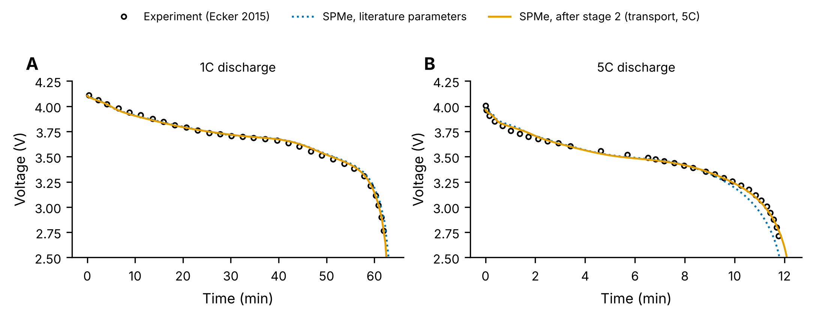
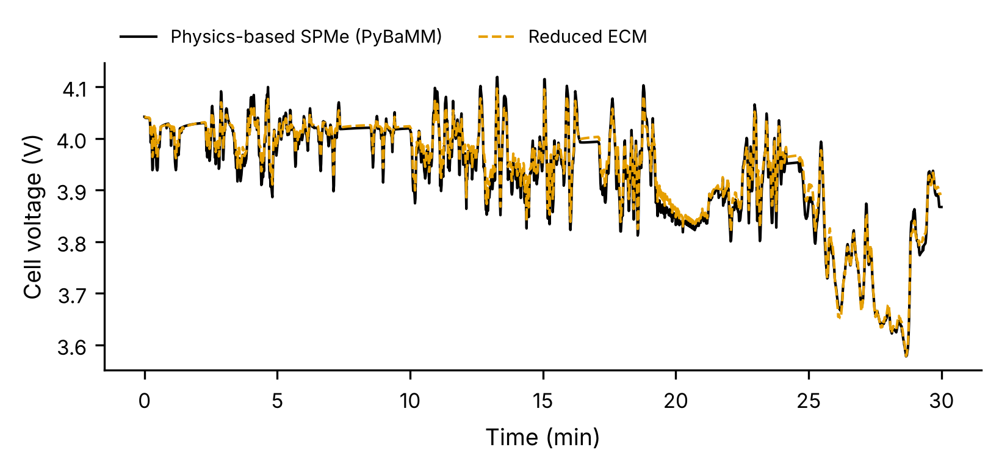
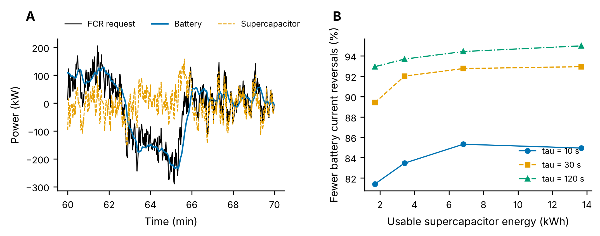
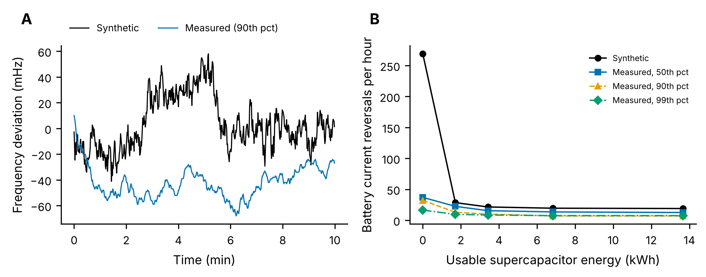

# Hybrid Energy Storage: Physics-Based Battery Models, FMU and Energy Management

A workflow from cell physics to system design for a hybrid energy storage system (HESS):

| Step | Question | Method |
|---|---|---|
| 1. Calibration | Does the physics-based model match measured cell data? | PyBaMM SPMe calibrated against experimental 1C and 5C discharges (Ecker 2015), two-stage least squares |
| 2. Reduction and screening | Which chemistry should act as the power device, and can a fast model replace the physics? | Virtual pulse tests on PyBaMM models of a Li-ion (Chen2020) and a Na-ion (Chayambuka2022) cell; one-RC equivalent-circuit model checked against the physics on a drive-cycle profile |
| 3. EMS, sizing and FMU | How large should the supercapacitor bank be, and how should power be split? | Battery-supercapacitor HESS for frequency containment reserve (FCR); filter-based EMS with state-of-charge feedback; sizing sweep; the plant packaged as an FMI 2.0 FMU and run in a co-simulation loop |
| 4. Measured frequency | Does the result hold with real grid frequency? | One year (2019) of measured Continental European frequency at 1 s; signal statistics and the step 3 sweep repeated on measured periods |

```bash
pip install -r requirements.txt
python step1_calibration.py      # about 1 min, downloads the Ecker data through pybamm.DataLoader
python step2_reduced_models.py   # about 1 min, writes models/ecm_*.json
python step3_ems_sizing.py       # about 1 min, uses fmu/HessFmu.fmu
python step4_measured_frequency.py  # about 7 min; needs data/frequency/freq_windows.npz (see step 4)
# rebuild the FMU after changing the plant or the models:
pythonfmu build -f fmu/HessFmu.py hess_plant.py ecm.py models --dest fmu
```

## Step 1: calibration against experimental data

Ecker et al. measured constant-current discharges of a Kokam pouch cell; PyBaMM ships the 1C and 5C curves and the matching Ecker2015 parameter set. The calibration uses each curve for what it can identify:

1. **Capacity balance from 1C** (close to equilibrium): negative electrode active material volume fraction.
2. **Transport and kinetics from 5C**: negative and positive particle diffusivities and the exchange-current density.

| Parameters | RMSE at 1C (mV) | RMSE at 5C (mV) |
|---|---:|---:|
| Literature (Ecker2015) | 36.9 | 81.5 |
| After stage 1 | 15.3 | 107.3 |
| **After stage 2** | **15.0** | **23.0** |

Stage 1 alone improves 1C but worsens 5C, which is why the second stage is fitted on high-rate data. Fitted multipliers: active material fraction 0.992, negative diffusivity 1.31, positive diffusivity 0.93, exchange-current density 0.85. With only two curves, both are used in fitting, so there is no fully independent validation set; a third rate or a pulse test would provide one.



## Step 2: reduced models and technology screening

A virtual pulse test (C/20 discharge for the open-circuit voltage; 2C pulses of 10 s with 60 s rest every 10% SOC) gives a one-RC equivalent-circuit model (ECM) per chemistry. Resistances are stored per unit capacity (Ω·Ah), so packs of any size can be built from them.

| Cell (PyBaMM parameter set) | R0 at 50% SOC (Ω·Ah) | R1 at 50% SOC (Ω·Ah) | τ at 50% SOC (s) | ECM vs physics, drive cycle (mV RMSE) |
|---|---:|---:|---:|---:|
| Li-ion, Chen2020 (SPMe) | 0.10 | 0.11 | 42 | 14.8 |
| Na-ion, Chayambuka2022 (DFN) | 0.19 | 0.24 | 128 | not used |

- **Screening result.** In these published parameter sets, the Na-ion cell has about twice the capacity-normalised resistance of the Li-ion cell, so it would not work as the power device of a Li-ion/Na-ion HESS. The power device in step 3 is therefore a supercapacitor bank. A Na-ion cell designed for power would need its own parameter set before this conclusion changes.
- **Reduced Li-ion model.** On a WLTC-shaped current profile (peak 2C), the ECM follows the SPMe within 14.8 mV RMS. The Na-ion one-RC model was not adequate on the same test, so it is used only for the screening above.



## Step 3: energy management, sizing and FMU

**Application.** A stationary 1 MW / 1 MWh Li-ion battery delivering 1 MW of FCR, using the reduced model from step 2. FCR makes the battery follow every frequency fluctuation, so it sees many fast current reversals. The frequency signal is synthetic (2 h at 1 s; slow and fast Ornstein-Uhlenbeck components with standard deviations of 20 and 6 mHz).

**Supercapacitor model.** Strings of 150 cells of 3000 F, 2.7 V and 0.29 mΩ ESR, typical datasheet values, used between half and full rated voltage.

**Energy management.** The battery follows the low-pass-filtered FCR request (time constant τ); the supercapacitor bank supplies the rest, with a feedback term that pulls its state of charge back to 50%.

| Bank (strings / usable kWh) | τ (s) | Battery current reversals per hour | Battery RMS C-rate | FCR error (% RMS) | Losses over 2 h (kWh) |
|---|---:|---:|---:|---:|---:|
| none (battery only) | | 269 | 0.097 | 0.00 | 0.78 |
| 5 / 1.7 | 10 | 50 | 0.093 | 0.00 | 1.07 |
| 5 / 1.7 | 30 | 29 | 0.091 | 0.03 | 1.29 |
| 5 / 1.7 | 120 | 19 | 0.080 | 1.31 | 1.32 |
| 20 / 6.8 | 30 | 20 | 0.083 | 0.00 | 0.82 |
| 40 / 13.7 | 120 | 14 | 0.065 | 0.00 | 0.58 |

(Full sweep in `results/step3_sizing.csv`.)

- Even the smallest bank, 1.7 kWh, removes 81 to 93% of the battery's current reversals, the micro-cycling that FCR imposes on it.
- A longer filter protects the battery more but empties a small bank: at τ = 120 s the 1.7 kWh bank runs out and FCR delivery suffers (1.3% error). Bank size and EMS tuning have to be chosen together.
- Small banks add losses (the supercapacitor works hard near half voltage), while large banks reduce them below the battery-only case. Energy efficiency, battery stress and bank cost pull in different directions, which is the trade-off a sizing study has to settle.



**FMU.** `fmu/HessFmu.fmu` is the battery-supercapacitor plant as an FMI 2.0 co-simulation FMU (inputs: battery and supercapacitor power set-points; outputs: delivered power, SOCs, voltages, losses). Step 3 runs the selected design (5 strings, τ = 30 s) through the FMU with fmpy as the co-simulation master, the role Simulink's FMU Import block would play, and the result matches the direct Python run exactly (`results/step3_fmu_check.csv`). The FMU is built with pythonfmu, so it needs a Python installation with numpy on the host; it has been checked with fmpy, not inside Simulink.

## Step 4: check with measured grid frequency

The synthetic signal of step 3 had a realistic overall spread, but how it was split between slow and fast fluctuations was a guess. Step 4 replaces it with measured Continental European frequency: one year (2019) at 1 s, recorded by the German TSO TransnetBW and pre-processed by Kruse, Schäfer and Witthaut ([Zenodo, doi:10.5281/zenodo.5105820](https://doi.org/10.5281/zenodo.5105820)).

| | Synthetic (step 3) | Measured, 2019 |
|---|---:|---:|
| Standard deviation | 19.3 mHz | 20.2 mHz |
| Change from one second to the next (SD) | 6.5 mHz | 1.3 mHz |
| Autocorrelation after 60 s / 300 s | 0.30 / 0.08 | 0.80 / 0.42 |
| FCR request reversals per hour (battery only) | 269 | 41 (year), 17 to 37 in the test periods |
| Full-power equivalent cycles per day | | 0.95 |

The spread was right, but the synthetic signal put far too much of it into fast, second-to-second noise. Real frequency moves slowly: it stays on one side of 50 Hz for minutes, with a strong pattern at the change of each hour (`results/step4_signal_comparison.csv`, `data/frequency/freq_stats.json`).

Repeating the step 3 sweep on three measured 2 h periods (median, 90th and 99th percentile variability of 2019):

- **The battery alone sees 7 to 16 times fewer current reversals** than with the synthetic signal (17 to 37 per hour instead of 269), and that is the problem the supercapacitor was meant to solve.
- **A supercapacitor bank still removes most of the remaining reversals**, but in absolute terms it saves only 10 to 25 reversals per hour, and the 80% target of step 3 is met in only one of the three periods, with the largest bank.
- **What drives battery stress on real frequency is the slow component.** The battery RMS C-rate rises from 0.087 to 0.156 between the median and the 99th-percentile period, and a supercapacitor sized in kWh cannot absorb deviations that last for minutes.

**Conclusion.** With measured Continental European frequency, a supercapacitor bank is hard to justify for FCR on micro-cycling grounds alone. The step 3 result was an artefact of the synthetic signal, which is why the model inputs needed checking against data. The supercapacitor case would need another argument, such as fast frequency response products with sub-second activation or very high cycle counts.



*A: 10 minutes of the synthetic signal and of measured frequency (90th-percentile period). B: battery current reversals per hour vs usable supercapacitor energy (τ = 30 s), synthetic and three measured periods.*

**Data handling.** `tools/prepare_frequency.py` turns `2019_cleansed.zip` into yearly and hourly statistics (`data/frequency/freq_stats.json`, `freq_hourly.csv`) and three 2 h excerpts (`freq_windows.npz`). It was run on a GitHub Actions runner (`tools/frequency_github_workflow.yml`). The TransnetBW recordings are not openly licensed, so the excerpts are not included in this repository; download the zip from Zenodo and run the script to recreate them.

## Limitations

- Calibration uses two published discharge curves of one cell; no independent validation set.
- The battery is represented by its reduced ECM in step 3: no thermal model and no ageing model. Current reversals and RMS C-rate are used as stress indicators, not as a degradation prediction.
- Step 4 uses three 2 h periods of measured frequency, not the full year, for the time-domain sweep; the yearly statistics come from all of 2019.
- The EMS is a filter with SOC feedback; an optimisation-based EMS (for example model predictive control) is the natural next step.

## Repository layout

```
step1_calibration.py      PyBaMM SPMe calibration against Ecker 2015 data
step2_reduced_models.py   pulse tests on PyBaMM models -> ECM parameters (models/*.json)
step3_ems_sizing.py       HESS EMS, sizing sweep and FMU co-simulation check
step4_measured_frequency.py  step 3 repeated with measured grid frequency
tools/prepare_frequency.py   condenses the 2019 frequency archive (statistics and excerpts)
ecm.py                    ECM cell and pack, supercapacitor bank
hess_plant.py             battery + supercapacitor plant (used directly and inside the FMU)
fmu/HessFmu.py            pythonfmu wrapper; fmu/HessFmu.fmu is the built FMU
plotstyle.py              figure style
figures/, results/
```

## Data and references

- Experimental discharge curves: M. Ecker et al., J. Electrochem. Soc. 162 (2015) A1836, distributed with PyBaMM.
- Parameter sets: Chen et al., J. Electrochem. Soc. 167 (2020) 080534 (Li-ion); Chayambuka et al., Electrochim. Acta (2022), physics-based modelling of sodium-ion batteries (Na-ion); both as implemented in PyBaMM.
- PyBaMM: V. Sulzer et al., J. Open Res. Softw. 9 (2021) 14.
- Grid frequency: J. Kruse, B. Schäfer, D. Witthaut, Pre-Processed Power Grid Frequency Time Series (Version 3), Zenodo (2021), doi:10.5281/zenodo.5105820; original recordings by TransnetBW GmbH. Paper: J. Kruse, B. Schäfer, D. Witthaut, IEEE Access 8 (2020) 149435.
